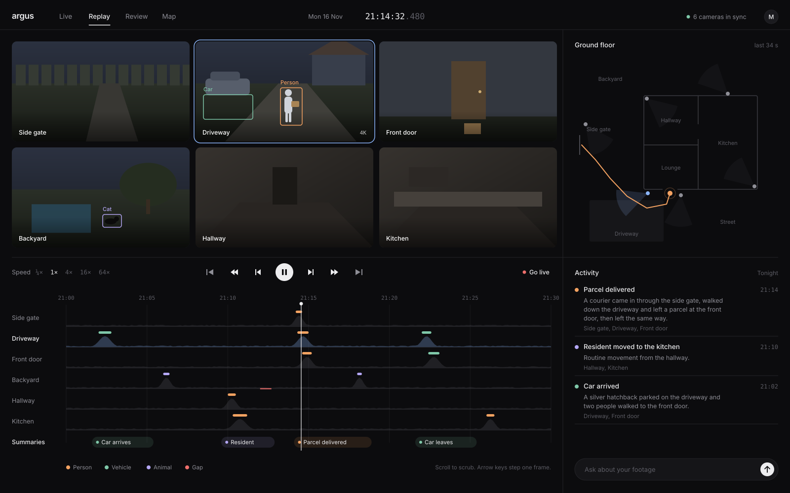

# Argus design system

Minimalist and flat: no glass, glows or gradients in the chrome. Colour is
reserved for meaning, and every colour means the same thing everywhere
(video overlays, floor plan, timeline, activity list).

## Type

| Use | Font |
| --- | --- |
| All text | [Geist](https://vercel.com/font) 400 / 500 / 600 |
| Times, numbers, codec info | Geist Mono 400 / 500, tabular figures |

Sizes: 11, 12.5, 13.5, 17 px. Headings use weight, not size.

## Colour tokens

| Token | Hex | Use |
| --- | --- | --- |
| `bg` | `#0C0C0E` | App background |
| `surface` | `#151518` | Inputs, raised controls |
| `line` | `#232327` | Hairline dividers |
| `text` | `#EDEDEF` | Primary text |
| `text-2` | `#8E8E96` | Secondary text |
| `text-3` | `#5C5C64` | Tertiary text, timestamps |
| `accent` | `#8AB4F8` | Selection and focus only |
| `person` | `#F4A261` | People |
| `vehicle` | `#7FC8A9` | Vehicles |
| `animal` | `#B4A7F5` | Animals |
| `alert` | `#EF6F6C` | Gaps, errors, live indicator |

Radii: 10 px for video tiles, 22 px for pill inputs. Strokes: 1 px hairlines,
1.5 px for detection boxes and focus outlines.
